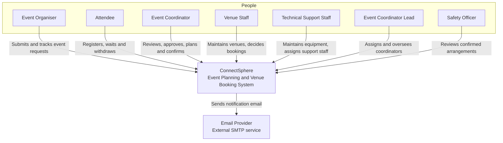
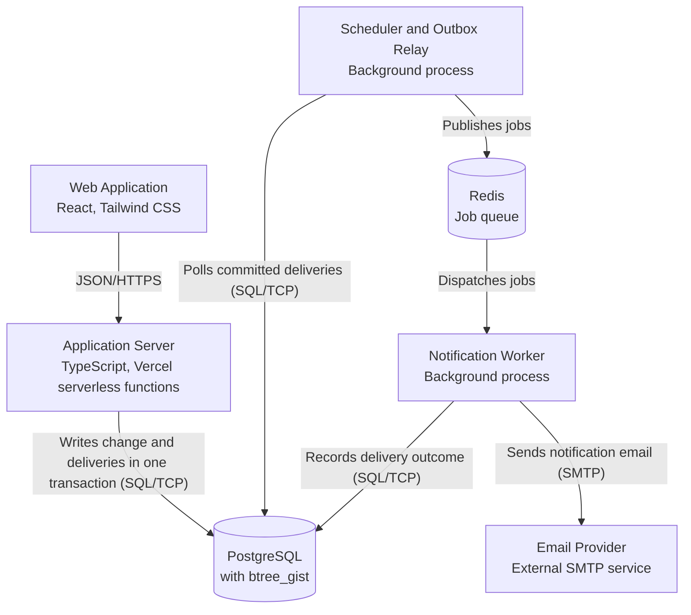

# ConnectSphere — Event Planning and Venue Booking System

**C4 model for the ConnectSphere release 1 modular monolith**

---

## Overview

ConnectSphere coordinates event requests, venue bookings, equipment, technical support and attendee registration on a single platform. It is built as a **modular monolith**: one Application Server container holding multiple domain and cross-cutting components, backed by a single PostgreSQL database, a Redis job queue, and two background processes for scheduling and notification delivery.

---

## People (Actors)

| Actor | Type | Description |
|---|---|---|
| **Event Organiser** | External User | External client representative who submits event requirements and tracks their organisation's events. |
| **Attendee** | External User | External participant who registers for and attends events. |
| **Event Coordinator** | Internal User | Internal staff member who owns planning for an event and acts as the main point of contact. |
| **Venue Staff** | Internal User | Internal staff responsible for the venue catalogue, availability and booking decisions. |
| **Technical Support Staff** | Internal User | Internal staff responsible for equipment availability, reservations and support-staff assignment. |
| **Event Coordinator Lead** | Internal User | Internal staff member who works the unassigned queue, assigns and reassigns Event Coordinators, and oversees every assignment and active event. Coordinators do not submit in-system reassignment requests (T-83). |
| **Safety Officer** | Internal User | Internal staff member who reviews an Event after arrangements are confirmed; the system starts Safety Review automatically and records the decision/comments plus the team's factor checklist (C-132, C-134, T-82). |

---

## External Systems

| System | Description |
|---|---|
| **Email Provider** | Third-party SMTP service used to deliver notification email to all seven roles. SMS is **not** in release 1 (see BDR T-35). |

---

## Level 1 — System Context

ConnectSphere sits between the seven user roles and the external Email Provider. Every actor reaches the system through the Web Application; the Email Provider delivers notification email out to all seven roles.

An account may hold more than one role; the roles above describe access grants,
not mutually exclusive account types. Seed data still assigns one role per account (T-86).

---

## Level 2 — Containers

The container table below is the reference detail for the diagram above.

| Container | Technology | Description |
|---|---|---|
| **Web Application** | React, Tailwind CSS | Responsive single-page application serving all seven roles on desktop and mobile. |
| **Application Server** | TypeScript (Node.js) — Vercel serverless functions | Modular monolith exposing a REST API: authentication/authorisation, event lifecycle, venue booking, equipment, registration and change management. |
| **Database** | PostgreSQL with `btree_gist` | Stores events, venues, bookings, equipment, reservations, registrations, notification outbox and audit log. |
| **Job Queue** | Redis | Holds notification jobs, published only after the originating transaction has committed. |
| **Scheduler and Outbox Relay** | Background process | Polls committed notification deliveries and publishes them; also runs periodic domain evaluations: auto-completing an event once its end time has passed and processing each hold's explicitly configured expiry and warning interval (T-84). |
| **Notification Worker** | Background process | Consumes queued jobs, calls the Email Provider, and records the delivery outcome. |

### Container relationships

| From | To | Description | Protocol |
|---|---|---|---|
| Web Application | Application Server | Calls | JSON/HTTPS |
| Application Server | Database | Writes the business change and its notification deliveries in one transaction | SQL/TCP |
| Scheduler and Outbox Relay | Database | Polls committed deliveries and evaluates due domain transitions | SQL/TCP |
| Scheduler and Outbox Relay | Job Queue | Publishes notification jobs to | — |
| Job Queue | Notification Worker | Dispatches jobs to | — |
| Notification Worker | Database | Records delivery outcome in | SQL/TCP |
| Notification Worker | Email Provider | Sends notification email via | SMTP |

> **ADR-006:** Notification jobs are published only *after* the originating transaction has committed — this is why the Scheduler/Outbox Relay, rather than the Application Server, is responsible for polling and publishing.

---

## Level 3 — Components (inside the Application Server)

> **ADR-001:** Component boundaries are enforced in code, not across the network — this is a modular monolith, not a set of microservices.

| Component | Type | Responsibility |
|---|---|---|
| **API Router** | REST controllers | Routes requests and validates payloads. |
| **Access Control** | Application service | Authentication, lockout, password reset, many-to-many role grants and client-organisation scoping; checks a caller's grants on every request (ADR-019). |
| **Event Lifecycle** | Application service | Request, review, clarification, approval, Session structure, status transitions, the unassigned queue and Lead-only assignment/reassignment, automatic Safety Review after readiness, reversion and completion; closes pending change requests as Obsolete on terminal status. |
| **Venue Management** | Application service | Session-linked bookings, per-venue setup/turnaround buffers, layouts, open-ended editable blocks with retained history, Session-level suitability, configured hold expiry/warning and reasoned extensions, booking decisions and routing from setup assignments. |
| **Equipment and Support** | Application service | Session-linked equipment requests/reservations and availability; Event-level technical-support requests and staff assignment. |
| **Registration** | Application service | Event-level registration window, attendee-selected Sessions, one active registration per account/Event, per-Session and combined Event capacity, Pending Organiser review, Event-level waitlist, withdrawal and attendance. |
| **Change Management** | Application service | Change requests, arrangement impact detection, Obsolete closure on Completed/Cancelled, and cancellation. |
| **Notification Dispatcher** | Application service | Resolves recipients and writes notification delivery rows inside the business transaction. |
| **Audit Logger** | Application service | Append-only record of status changes, access denials, booking decisions and deactivations. |
| **Data Access Layer** | ORM and repositories | Repositories, transactions, `tstzrange` columns and `EXCLUDE` constraint enforcement. |

### Component relationships

**Routing and authorisation**
- API Router → Access Control — authorises every request through
- Access Control → Event Lifecycle — delegates to
- Access Control → Registration — delegates to
- Access Control → Change Management — delegates to

**Domain collaboration**
- Event Lifecycle → Venue Management — requests venue booking from
- Event Lifecycle → Equipment and Support — requests equipment reservation from
- Registration → Event Lifecycle — blocks until the event is Confirmed
- Registration → Venue Management — reads booked venue capacity from
- Registration → Event Lifecycle — reads selected Session periods and Event status from
- Change Management → Venue Management — flags affected bookings in
- Change Management → Equipment and Support — flags affected reservations in
- Change Management → Event Lifecycle — applies approved changes through

**Notifications**
- Event Lifecycle → Notification Dispatcher — raises notifications through
- Venue Management → Notification Dispatcher — raises notifications through
- Equipment and Support → Notification Dispatcher — raises notifications through
- Registration → Notification Dispatcher — raises notifications through
- Change Management → Notification Dispatcher — raises notifications through

**Auditing**
- Event Lifecycle → Audit Logger — records actions through
- Access Control → Audit Logger — records denied access through
- Venue Management → Audit Logger — records booking decisions through

**Persistence**
- Notification Dispatcher → Data Access Layer — writes delivery rows through
- Audit Logger → Data Access Layer — writes entries through
- Event Lifecycle → Data Access Layer — persists through
- Venue Management → Data Access Layer — persists through
- Equipment and Support → Data Access Layer — persists through
- Registration → Data Access Layer — persists through
- Change Management → Data Access Layer — persists through
- Data Access Layer → Database — reads from and writes to (SQL/TCP)

*(Diagram: "Components" — Level 3, auto-layout top-to-bottom, includes all elements.)*

---

## Diagram Views Summary

| View | Level | Scope |
|---|---|---|
| **SystemContext** | 1 | ConnectSphere, its seven user roles, and the one external system it depends on. |
| **Containers** | 2 | One deployable application server, one database, and two background processes. Notification jobs are published only after commit (ADR-006). |
| **Components** | 3 | Domain and cross-cutting components inside the modular monolith. Boundaries are in code, not across the network (ADR-001). |

---

## Styling Reference

| Element Tag | Shape | Background | Text Color |
|---|---|---|---|
| Person | Person | `#08427b` | `#ffffff` |
| External User | (default) | `#686868` | `#ffffff` |
| Internal User | (default) | `#08427b` | `#ffffff` |
| Software System | (default) | `#1168bd` | `#ffffff` |
| External System | (default) | `#999999` | `#ffffff` |
| Container | (default) | `#438dd5` | `#ffffff` |
| Database | Cylinder | `#438dd5` | `#ffffff` |
| Component | (default) | `#85bbf0` | `#000000` |

---

## Referenced Decisions

- **ADR-001** — Component boundaries are enforced in code, not across the network (modular monolith design).
- **ADR-006** — Notification jobs are published to the queue only after the originating transaction has committed.
- **BDR T-35** — SMS notifications are out of scope for release 1; email only.

### Date-horizon verification (SCRUM-180)

The existing application-checks PostgreSQL Event lifecycle step also executes
`eventDateHorizon.integration.test.ts`: real API authentication, field errors,
draft refusal/correction, and sole-Session persistence. No component, external
service or deployment topology is added. The shared Session validation handoff
is in [the Event date-horizon contract](contracts/event-date-horizon.md).

## E11 registration-notice publication boundary

Organiser-managed registration approval/rejection/manual addition reads the
published Event name for attendee notifications, while the Organiser's own
registration screen keeps its internal Event view. Without a publication the
public notice is suppressed, following T-64's shared recipient policy. Business
writes, audit and any eligible in-app/email-outbox rows share the transaction;
no live provider call runs in that transaction. The E11 cross-flow database
suite is part of `backend`'s `test:db` command. See the 31 October E11 evidence
audit for exact local/production/human delivery boundaries.
