## Class diagram — Week 9 Session, booking and event lifecycle model

Version 2 · 13 October 2026

This diagram traces the Week 7/Week 9 booking, Session, registration, access and
event-lifecycle decisions to the domain objects that own them. It is a domain model
of the `Event Lifecycle`, `Venue Management`, `Equipment and Support`, `Registration`
and `Access Control` components in `docs/c4-diagrams.md`: a domain model realized
by functional services in the backend rather than by stateful classes, with the
Implementation mapping table below as the code correspondence. Where a class maps
to a table in `docs/db_schema.md`, the table is named in a note. Week 9 decisions
are marked `W9`.

### Venue booking

```mermaid
classDiagram
    direction LR

    class Venue {
        +uuid id
        +string name
        +string location
        +int maxCapacity
        +int setupMinutes W7
        +int turnaroundMinutes W7
        +Time opensAt
        +Time closesAt
        +bool isActive
        +occupancyWindow(range) Range W7
        +isFree(range) bool W7
        +recordUnavailability(range, category, note) VenueBlock W7
        +retire()
    }

    class VenueBooking {
        +uuid id
        +uuid eventId
        +uuid sessionId W9
        +uuid layoutId W9
        +Range bookingRange
        +Range occupancyRange W7
        +BookingStatus status
        +string purpose W7
        +int headcount W7
        +bool isPrimary W7
        +DateTime expiresAt W7
        +Duration warningBefore W9
        +DateTime reminderSentAt
        +int extensionCount W9
        +BookingStatus statusBeforeConflict "restored when the unavailability ends" W7
        +uuid conflictBlockId W7
        +bool requiresReconfirmation
        +string decisionReason
        +requestBooking()
        +confirm(decidedBy)
        +reject(decidedBy, reason, suggestedVenue)
        +release()
        +markConflicting(reason) W7
        +expire() W7
        +extend(newExpiry, reason, by) W9
        +convertHoldToRequest() W7
    }

    class VenueBlock {
        +uuid id
        +Range blockRange "nullable end" W9
        +UnavailabilityReason reasonCategory W7
        +string reason
        +DateTime liftedAt W9
        +edit(newRange, newReason, by) W9
        +lift(by) W9
    }

    class VenueBlockHistory {
        +uuid id
        +string action
        +Range previousRange
        +Range newRange
        +UnavailabilityReason previousCategory
        +UnavailabilityReason newCategory
        +string previousReason
        +string newReason
        +uuid actorId
        +DateTime changedAt
    }

    class VenueHoldExtension {
        +uuid id
        +int extensionNumber "maximum 2" W9
        +DateTime previousExpiry
        +DateTime newExpiry
        +string reason
        +uuid extendedBy
        +DateTime extendedAt
    }

    class Session {
        +uuid id
        +Range sessionRange W9
        +int expectedAttendance W9
        +uuid layoutId W9
        +string venueRequirements W9
        +string equipmentRequirements W9
    }

    class Event {
        +uuid id
    }

    class BookingStatus {
        <<enumeration>>
        pending
        tentative W7
        confirmed
        rejected
        released
        conflicting
        expired W7
    }

    class UnavailabilityReason {
        <<enumeration>>
        maintenance
        equipment_failure
        renovation
        safety_concern
        other
    }

    class HoldExpiryJob {
        <<service>>
        +run(now) W7
        +expireDueHolds(now)
        +sendDueReminders(now)
    }

    Venue "1" o-- "0..*" VenueBooking : hosts
    Venue "1" o-- "0..*" VenueBlock : unavailableDuring
    Event "1" o-- "1..*" Session : contains
    Session "1" --> "0..*" VenueBooking : scheduledFor
    VenueBooking "1" o-- "0..2" VenueHoldExtension : extensionHistory
    VenueBooking --> BookingStatus
    VenueBlock --> UnavailabilityReason
    VenueBlock "1" o-- "0..*" VenueBlockHistory : changes
    HoldExpiryJob ..> VenueBooking : expires and reminds
    VenueBooking "0..1" --> "0..1" Venue : suggestedVenue on rejection

    note for Venue "Table VENUES. occupancyWindow() widens event-use/hold ranges by setupMinutes and turnaroundMinutes. Maintenance blocks use their raw, possibly open-ended range and receive no buffer (T-80)."
    note for VenueBooking "Table VENUE_BOOKINGS. occupancyRange is filled on write and is what the exclusion constraint keys on (ADR-003 amended). Every booking belongs to one Session; missing headcount falls back to that Session's expectedAttendance. Holds have explicitly configured expiry/warning and at most two reasoned extensions (T-79/T-84)."
    note for VenueBlock "Tables VENUE_BLOCKS and VENUE_BLOCK_HISTORY. Lift retains the block and its history; each edit snapshots old/new range and reason. Affected Coordinators receive a lift notice (T-91)."
    note for HoldExpiryJob "Runs inside the Scheduler and Outbox Relay poll (ADR-006 amended). It evaluates each configured expiry and warning interval; no system default is applied (T-84)."
```

### Event lifecycle

```mermaid
classDiagram
    direction TB

    class Event {
        +uuid id
        +string title
        +EventStatus status
        +int expectedAttendance
        +uuid organiserId
        +uuid coordinatorId
        +DateTime coordinatorAssignedAt
        +uuid assignedBy W7
        +submit()
        +assignCoordinator(lead, coordinator) W7
        +reassignCoordinator(lead, coordinator) W7
        +approve(reason)
        +reject(reason)
        +requestClarification(question)
        +startPlanning()
        +startSafetyReviewWhenReady() W9
        +recordSafetyDecision(check) W7
        +revertToPlanning(reason)
        +cancel(reason)
        +complete()
        +arrangementsComplete() bool W7
    }

    class EventStatus {
        <<enumeration>>
        draft
        submitted
        under_review
        awaiting_clarification
        rejected
        approved
        planning
        safety_review W7
        confirmed
        cancelled
        completed
    }

    class CoordinatorReassignment {
        <<legacy history only>>
        +uuid id
        +uuid fromCoordinatorId
        +uuid toCoordinatorId
        +bool addressedToLead W7
        +ReassignmentStatus status
    }

    class Session {
        +uuid id
        +Range sessionRange W9
        +int expectedAttendance W9
        +uuid layoutId W9
    }

    class SafetyCheck {
        +uuid id
        +uuid safetyOfficerId
        +SafetyDecision decision
        +string comments W9
        +DateTime createdAt "created automatically" W9
        +DateTime decidedAt
        +assessFactor(factor, satisfactory, comment)
        +approve(comments)
        +requestChanges(comments)
        +reject(comments)
        +isComplete() bool
    }

    class SafetyCheckFactor {
        +SafetyFactor factor
        +bool satisfactory
        +string comment
    }

    class SafetyFactor {
        <<enumeration>>
        attendance_vs_capacity
        capacity_and_layout
        emergency_access
        accessibility
        equipment_placement
        crowd_movement
        venue_restrictions
    }

    class SafetyDecision {
        <<enumeration>>
        approved
        changes_requested
        rejected
    }

    class UnassignedQueue {
        <<service>>
        +list() Event[] W7
        +coordinatorWorkload() Map W7
    }

    class User {
        +uuid id
        +UserRole[] roles W9
        +string fullName
    }

    class UserRole {
        <<enumeration>>
        event_organiser
        event_coordinator
        event_coordinator_lead W7
        venue_staff
        technical_support_staff
        safety_officer W7
        attendee
    }

    Event --> EventStatus
    Event "1" o-- "1..*" Session : contains W9
    Event "1" o-- "0..*" CoordinatorReassignment : handedOverBy
    Event "1" o-- "0..*" SafetyCheck : reviewedBy
    SafetyCheck "1" *-- "7" SafetyCheckFactor : assesses
    SafetyCheckFactor --> SafetyFactor
    SafetyCheck --> SafetyDecision
    User "1" o-- "1..*" UserRole : grants W9
    User "0..1" --> "0..*" Event : coordinates
    User "1" --> "0..*" Event : organises
    User "0..1" --> "0..*" Event : assignedBy (Lead)
    User "1" --> "0..*" SafetyCheck : decides (Safety Officer)
    UnassignedQueue ..> Event : reads submitted and unassigned

    note for Event "Table EVENTS. Event expectedAttendance is the overall planning total; each Session has its own attendance used for that Session's booking-suitability fallback (T-79). A Lead assigns or reassigns Coordinators directly; no Coordinator request/acceptance workflow is available (T-83). When arrangementsComplete() becomes true, the system creates SafetyCheck and moves Planning to Safety Review (T-82)."
    note for SafetyCheck "Table SAFETY_CHECKS; decision/comments are null while pending. SAFETY_CHECK_FACTORS stores the team-added checklist. The pending record is automatic; the Safety Officer records overall decision/comments plus each factor. Approval moves the Event to Confirmed; changes/rejection return it to Planning and never cancel it. Every transition is audited (ADR-009 amended)."
    note for CoordinatorReassignment "Legacy history only. New reassignment is written as a Lead action in the audit log; no new request, accept or decline rows are created after T-83."
```

### Sessions and Event registration

```mermaid
classDiagram
    direction LR

    class Event {
        +uuid id
        +Range eventRange
        +DateTime registrationOpensAt
        +DateTime registrationClosesAt
        +int combinedCapacity()
    }

    class Session {
        +uuid id
        +Range sessionRange
        +int expectedAttendance
        +uuid layoutId
        +int confirmedLayoutCapacity()
    }

    class EventRegistration {
        +uuid id
        +RegistrationStatus status
        +DateTime registeredAt
        +bool manuallyAdded
        +withdraw()
    }

    class RegistrationSession {
        +uuid registrationId
        +uuid sessionId
        +DateTime selectedAt
    }

    class RegistrationStatus {
        <<enumeration>>
        registered
        waitlisted
        pending
        rejected
        withdrawn
    }

    class CapacityService {
        <<service>>
        +checkSessionAndEventCapacity(registration) Result
        +approvePending(registrationId) Result
    }

    Event "1" o-- "1..*" Session : contains
    Event "1" o-- "0..*" EventRegistration : admits
    Session "1" o-- "0..*" RegistrationSession : selectedBy
    EventRegistration "1" o-- "1..*" RegistrationSession : selects
    EventRegistration --> RegistrationStatus
    CapacityService ..> Session : checks each selected capacity
    CapacityService ..> Event : checks combined capacity

    note for EventRegistration "Tables EVENT_REGISTRATIONS and EVENT_REGISTRATION_SESSIONS. One active registration per account/Event selects one or more Sessions. Pending over-capacity submissions do not occupy approved seats; approval rechecks both limits (T-85). Event-level waitlist remains for combined capacity; there is no per-Session waitlist (T-98)."
    note for CapacityService "Session capacity is derived from confirmed Session layout capacity. Combined Event capacity is derived from confirmed Session layout capacities. The limits are enforced atomically across concurrent registration/approval writes (T-85)."
```

### Reading the two diagrams together

- A `VenueBooking` belongs to one Session; each Session belongs to one Event.
  `Event.arrangementsComplete()` checks all required Session bookings and
  equipment plus Event-level technical support (T-79/T-82).
- The system automatically creates the pending `SafetyCheck` when arrangements
  complete; a Coordinator does not submit it. `SafetyCheck.approve()` is the
  only transition from Safety Review to Confirmed (T-82).
- `HoldExpiryJob` and `UnassignedQueue` are stereotyped `<<service>>` because they
  own no state of their own; both read and write through the classes they point at.

### Implementation mapping

Every diagrammed method resolves to a function in the backend modules.

| Diagrammed method | Implementation site |
| --- | --- |
| `Event.submit()` | `backend/src/modules/eventLifecycle/service.ts:createEventRequest` |
| `Event.approve()` / `Event.reject()` | `backend/src/modules/eventLifecycle/decision.ts:decideEventRequest` |
| `Event.requestClarification()` | `backend/src/modules/eventLifecycle/clarification.ts:requestClarification` |
| `Event.cancel()` | `backend/src/modules/eventLifecycle/cancellation.ts:cancelEvent` |
| `Event.complete()` | `backend/src/modules/eventLifecycle/completion.ts:completeEvent` |
| `Event.assignCoordinator()` | `backend/src/modules/eventLifecycle/coordinatorAssignment.ts:assignCoordinatorOnSubmit` |
| `Event.reassignCoordinator()` | `backend/src/modules/eventLifecycle/coordinatorAssignment.ts` (a Lead action recorded in the audit log, not a function) |
| `VenueBooking.confirm()` / `VenueBooking.reject()` | `backend/src/modules/venueBooking/decisions.ts:decideBooking` |
| `VenueBooking.expire()` / `VenueBooking.extend()` | `backend/src/modules/venueBooking/holds.ts:expireHolds` and `:extendHold` |
| `VenueBlock.edit()` | `backend/src/modules/venueBooking/blocks.ts:editVenueBlock` (open-ended ranges via `:shortenVenueBlock`) |
| `VenueBlock.lift()` | `backend/src/modules/venueBooking/blocks.ts:liftVenueBlock` |
| `EventRegistration.withdraw()` | `backend/src/modules/attendeeRegistration/service.ts:withdrawRegistration` |
| `CapacityService.checkSessionAndEventCapacity()` | `backend/src/modules/attendeeRegistration/capacity.ts:eventCapacity` and `:overCapacity` |

### Change log

- v1 (3 October 2026): first version for the Week 7 Customer Changes.
- v2 (13 October 2026): added Sessions, registration, roles, hold and block
  history; updated lifecycle, assignment and Safety Review for T-79 to T-91.
