## Database schema

```mermaid
erDiagram
    CLIENT_ORGANISATIONS ||--o{ USERS : "employs"
    CLIENT_ORGANISATIONS ||--o{ EVENTS : "owns"
    USERS ||--o{ PASSWORD_RESET_TOKENS : "has"
    USERS ||--o{ EVENTS : "organises_or_coordinates"
    USERS ||--o{ USER_ROLES : "holds"

    EVENTS ||--|{ SESSIONS : "contains"
    ROOM_LAYOUTS ||--o{ SESSIONS : "planned_as"
    SESSIONS ||--o{ VENUE_BOOKINGS : "booked_for"
    VENUES ||--o{ VENUE_BOOKINGS : "hosts"
    VENUES ||--o{ VENUE_BLOCKS : "unavailable_during"
    VENUE_BLOCKS ||--o{ VENUE_BLOCK_HISTORY : "change_history"
    VENUE_BLOCKS |o--o{ VENUE_BOOKINGS : "holds_conflicting"
    VENUE_BOOKINGS ||--o{ VENUE_HOLD_EXTENSIONS : "extended_by"
    VENUES ||--o{ VENUE_STAFF_ASSIGNMENTS : "routed_to"
    USERS ||--o{ VENUE_STAFF_ASSIGNMENTS : "assigned_to"
    VENUES ||--|{ VENUE_SUPPORTED_LAYOUTS : "supports"
    ROOM_LAYOUTS ||--o{ VENUE_SUPPORTED_LAYOUTS : "offered_as"

    VENUES ||--o{ VENUE_ACCESSIBILITY_FEATURES : "provides"
    ACCESSIBILITY_FEATURES ||--o{ VENUE_ACCESSIBILITY_FEATURES : "offered_as"
    SESSIONS ||--o{ SESSION_ACCESSIBILITY_NEEDS : "requires"
    ACCESSIBILITY_FEATURES ||--o{ SESSION_ACCESSIBILITY_NEEDS : "needed_as"

    VENUES ||--o{ VENUE_FACILITIES : "offers"
    FACILITIES ||--o{ VENUE_FACILITIES : "offered_as"
    SESSIONS ||--o{ SESSION_FACILITY_NEEDS : "requires"
    FACILITIES ||--o{ SESSION_FACILITY_NEEDS : "needed_as"

    SESSIONS ||--o{ EQUIPMENT_REQUESTS : "needs"
    EQUIPMENT ||--o{ EQUIPMENT_REQUESTS : "requested_as"
    EQUIPMENT_REQUESTS ||--o{ EQUIPMENT_RESERVATIONS : "fulfilled_by"
    EQUIPMENT ||--o{ EQUIPMENT_RESERVATIONS : "allocated_as"
    EQUIPMENT ||--o{ EQUIPMENT_UNAVAILABILITY : "withdrawn_during"

    EVENTS ||--o{ TECH_SUPPORT_REQUESTS : "requires"
    TECH_SUPPORT_REQUESTS ||--o{ TECH_STAFF_ASSIGNMENTS : "staffed_by"
    USERS ||--o{ TECH_STAFF_ASSIGNMENTS : "assigned_to"

    EVENTS ||--o{ EVENT_REGISTRATIONS : "admits"
    USERS ||--o{ EVENT_REGISTRATIONS : "registers"
    EVENT_REGISTRATIONS ||--o{ EVENT_REGISTRATION_SESSIONS : "selects"
    SESSIONS ||--o{ EVENT_REGISTRATION_SESSIONS : "attended_as"
    EVENT_REGISTRATIONS ||--o| EVENT_ATTENDANCE : "recorded_as"

    EVENTS ||--o{ EVENT_THREADS : "discussed_in"
    USERS ||--o{ EVENT_THREADS : "authors"
    EVENTS ||--o{ COORDINATOR_REASSIGNMENTS : "legacy_history_only"
    EVENTS ||--o{ SAFETY_CHECKS : "reviewed_by"
    USERS ||--o{ SAFETY_CHECKS : "decides"
    SAFETY_CHECKS ||--|{ SAFETY_CHECK_FACTORS : "assesses"
    USERS ||--o{ COORDINATOR_REASSIGNMENTS : "legacy_request_history"
    EVENTS ||--o{ CHANGE_REQUESTS : "amended_by"
    USERS ||--o{ CHANGE_REQUESTS : "raises"

    USERS ||--o{ NOTIFICATIONS : "receives"
    NOTIFICATIONS ||--|{ NOTIFICATION_DELIVERIES : "delivered_via"
    EVENTS ||--o{ NOTIFICATIONS : "triggers"
    USERS ||--o{ AUDIT_LOGS : "performs"
    EVENTS ||--o{ AUDIT_LOGS : "tracked_by"

    CLIENT_ORGANISATIONS {
        uuid id PK
        varchar name UK
        varchar contact_email
        boolean is_active
        timestamptz created_at
    }

    USERS {
        uuid id PK
        uuid client_org_id FK "null for internal staff and attendees"
        varchar email UK
        varchar password_hash
        varchar full_name
        varchar contact_number
        boolean is_active "false once deactivated"
        timestamptz deactivated_at
        smallint failed_login_count "lockout at 5"
        timestamptz locked_until
        timestamptz created_at
    }

    USER_ROLES {
        uuid user_id PK,FK
        user_role role PK "many roles may be held; seed accounts start with one role (T-86)"
        timestamptz granted_at
        uuid granted_by FK "null for migration or seed"
    }

    PASSWORD_RESET_TOKENS {
        uuid id PK
        uuid user_id FK
        varchar token_hash "hash only, never the raw token"
        timestamptz expires_at
        timestamptz used_at "single use; null until redeemed"
        timestamptz created_at
    }

    EVENTS {
        uuid id PK
        uuid organiser_id FK
        uuid coordinator_id FK "null while unassigned; assigned or directly reassigned by a Lead (T-83)"
        timestamptz coordinator_assigned_at "when the current Coordinator took over"
        uuid assigned_by FK "the Lead who assigned or reassigned; null for legacy or unassigned rows"
        uuid client_org_id FK
        varchar title
        text description
        text purpose
        event_status status "11 canonical statuses; Week 7 adds safety_review between planning and confirmed"
        text decision_reason "rejection, cancellation or reversion"
        timestamptz status_changed_at
        boolean registration_enabled
        boolean waitlist_enabled
        timestamptz registration_opens_at
        timestamptz registration_closes_at
        timestamptz withdrawal_deadline
        tstzrange event_range "overall event envelope derived from its Sessions"
        int expected_attendance "event-level planning total, not a registration cap or per-Session booking fallback"
        text registration_setup "free text; 'none_required' sentinel means explicitly opted out"
        timestamptz created_at
    }

    SESSIONS {
        uuid id PK
        uuid event_id FK "Event owns one or more Sessions"
        varchar title
        tstzrange session_range "Session-specific start/end; within event_range"
        int expected_attendance "per-Session suitability fallback when booking headcount is absent (T-79)"
        uuid layout_id FK
        text venue_requirements "free text; 'none_required' sentinel means explicitly opted out"
        text accessibility_note "free text; excluded from automated matching"
        text equipment_requirements "free text; 'none_required' sentinel means explicitly opted out"
        text layout_preference "free text organiser input, distinct from confirmed layout_id"
        timestamptz created_at
        "UNIQUE (id, event_id) supports session ownership composite foreign keys"
    }

    VENUES {
        uuid id PK
        varchar name
        varchar location
        int max_capacity
        int setup_time_minutes "Week 7 C-65; default 0; migration 0011 in PR #231"
        int turnaround_time_minutes "Week 7 C-65; default 0; migration 0011 in PR #231"
        time opens_at
        time closes_at
        boolean is_active "false once retired"
        timestamptz created_at
    }

    ROOM_LAYOUTS {
        uuid id PK
        varchar code UK
        varchar label
    }

    VENUE_SUPPORTED_LAYOUTS {
        uuid venue_id PK,FK
        uuid layout_id PK,FK
        int capacity
    }

    ACCESSIBILITY_FEATURES {
        uuid id PK
        varchar code UK
        varchar label
    }

    VENUE_ACCESSIBILITY_FEATURES {
        uuid venue_id PK,FK
        uuid feature_id PK,FK
    }

    SESSION_ACCESSIBILITY_NEEDS {
        uuid session_id PK,FK
        uuid feature_id PK,FK
    }

    FACILITIES {
        uuid id PK
        varchar code UK
        varchar label
    }

    VENUE_FACILITIES {
        uuid venue_id PK,FK
        uuid facility_id PK,FK
    }

    SESSION_FACILITY_NEEDS {
        uuid session_id PK,FK
        uuid facility_id PK,FK
    }

    VENUE_BOOKINGS {
        uuid id PK
        uuid venue_id FK
        uuid event_id FK "denormalised with session_id and checked by composite FK"
        uuid session_id FK
        uuid layout_id FK "confirmed layout for this Session at this Venue"
        tstzrange booking_range "within the linked Session's period"
        tstzrange occupancy_range "application-maintained: booking_range widened by the venue's setup and turnaround at write time; the EXCLUDE constraint keys on this (ADR-003)"
        booking_status status "pending, tentative, confirmed, rejected, released, conflicting, expired"
        booking_status status_before_conflict "set while an unavailability holds the booking Conflicting: pending, confirmed or tentative (C-111, C-122)"
        uuid conflict_block_id FK "the unavailability that made it Conflicting"
        text purpose "Week 7 C-67; e.g. Main programme, Breakout A"
        int headcount "Week 7 C-67; governs suitability for this venue, falls back to SESSIONS.expected_attendance (T-79)"
        boolean is_primary "Week 7 C-67; only a Confirmed booking may be primary (O-30)"
        uuid requested_by FK "Coordinator who submitted the formal request; null for legacy/unsubmitted rows"
        timestamptz requested_at "when a tentative hold became a formal request or direct request was submitted"
        uuid submission_key "idempotency key for a direct request; null for legacy/hold rows"
        timestamptz expires_at "tentative holds only; explicitly configured per hold, no system default (C-99, C-124)"
        interval warning_before "Coordinator-configured warning interval per hold (C-125)"
        timestamptz reminder_sent_at
        boolean requires_reconfirmation
        text decision_reason
        uuid suggested_venue_id FK "alternative offered on rejection"
        uuid decided_by FK
        timestamptz decided_at
        timestamptz created_at
    }

    VENUE_BLOCKS {
        uuid id PK
        uuid venue_id FK
        tstzrange block_range "lower bound required; upper bound may be open until lifted; no buffers"
        unavailability_reason reason_category "Week 7 C-66: maintenance, equipment_failure, renovation, safety_concern, other"
        varchar reason "free-text note"
        uuid created_by FK
        timestamptz created_at
        timestamptz lifted_at "null while active; lifting retains the row and history"
        uuid lifted_by FK
    }

    VENUE_BLOCK_HISTORY {
        uuid id PK
        uuid block_id FK
        varchar action "created, edited, lifted"
        tstzrange previous_range "null for creation"
        tstzrange new_range "null for lift"
        unavailability_reason previous_category
        unavailability_reason new_category
        varchar previous_reason
        varchar new_reason
        uuid actor_id FK "null only for system-originated changes"
        timestamptz changed_at
    }

    VENUE_STAFF_ASSIGNMENTS {
        uuid venue_id PK,FK
        uuid staff_id PK,FK
        timestamptz active_from
        timestamptz active_until
        "setup/routing data; no Release 1 roster-management screen (T-89)"
    }

    VENUE_HOLD_EXTENSIONS {
        uuid id PK
        uuid booking_id FK
        smallint extension_number "1 or 2; unique per booking"
        timestamptz previous_expiry
        timestamptz new_expiry
        text reason "required for every extension"
        uuid extended_by FK "Venue Staff"
        timestamptz extended_at
    }

    EQUIPMENT {
        uuid id PK
        varchar name
        varchar category
        text description
        equipment_status operational_status "standing state; see EQUIPMENT_UNAVAILABILITY for dated withdrawals"
        int total_quantity
        varchar home_location
        boolean is_active
    }

    EQUIPMENT_UNAVAILABILITY {
        uuid id PK
        uuid equipment_id FK
        int quantity
        tstzrange unavailable_range
        varchar reason
        timestamptz created_at
    }

    EQUIPMENT_REQUESTS {
        uuid id PK
        uuid event_id FK
        uuid session_id FK
        uuid equipment_id FK
        int quantity_requested
        text technical_notes
        uuid requested_by FK
        timestamptz created_at
    }

    EQUIPMENT_RESERVATIONS {
        uuid id PK
        uuid request_id FK
        uuid event_id FK
        uuid session_id FK
        uuid equipment_id FK
        int quantity_reserved
        tstzrange reservation_range
        reservation_status status "reserved, partial, released"
        boolean requires_reconfirmation
        uuid reserved_by FK
        timestamptz created_at
    }

    TECH_SUPPORT_REQUESTS {
        uuid id PK
        uuid event_id FK
        boolean support_required
        text support_description
        tstzrange support_range
        support_status status "open, staffed, cancelled"
        uuid requested_by FK
        timestamptz created_at
    }

    TECH_STAFF_ASSIGNMENTS {
        uuid id PK
        uuid request_id FK
        uuid event_id FK
        uuid staff_id FK
        tstzrange assignment_range
        assignment_status status
        timestamptz created_at
    }

    EVENT_REGISTRATIONS {
        uuid id PK
        uuid event_id FK
        uuid attendee_id FK "at most one active registration with event_id"
        registration_status status "registered, waitlisted, pending, rejected, withdrawn"
        boolean manually_added "distinguishes Organiser-added attendee (T-50)"
        timestamptz registered_at "orders first-come waitlist claims"
        timestamptz withdrawn_at
    }

    EVENT_REGISTRATION_SESSIONS {
        uuid registration_id PK,FK
        uuid event_id FK "same Event as registration and Session"
        uuid session_id PK,FK
        timestamptz selected_at
        "composite FKs prevent selecting a Session belonging to another Event"
    }

    EVENT_ATTENDANCE {
        uuid id PK
        uuid registration_id FK
        boolean attended
        uuid recorded_by FK
        timestamptz recorded_at
    }

    EVENT_THREADS {
        uuid id PK
        uuid event_id FK
        uuid author_id FK
        thread_type type "comment, clarification_request, clarification_response"
        text body
        uuid parent_id FK
        timestamptz resolved_at
        timestamptz created_at
    }

    COORDINATOR_REASSIGNMENTS {
        uuid id PK
        uuid event_id FK
        uuid from_coordinator_id FK "legacy requestor; historical rows only"
        uuid to_coordinator_id FK "legacy target; historical rows only"
        reassignment_status status "legacy pending/accepted/declined history; no new request rows after T-83"
        boolean addressed_to_lead "legacy Week 7 field; no Coordinator-to-Lead request flow after T-83"
        timestamptz requested_at
        timestamptz decided_at "null while pending"
    }

    CHANGE_REQUESTS {
        uuid id PK
        uuid event_id FK
        uuid requested_by FK
        text description
        jsonb requested_changes
        change_status status "pending, approved, declined, applied, obsolete"
        uuid reviewed_by FK
        text decision_reason
        timestamptz closed_at "set for terminal decision, including automatic Obsolete"
        timestamptz reviewed_at
        timestamptz created_at
    }

    NOTIFICATIONS {
        uuid id PK
        uuid user_id FK
        uuid event_id FK
        varchar title
        text message
        boolean is_read "one read state per notification, not per channel"
        timestamptz read_at
        timestamptz created_at
    }

    NOTIFICATION_DELIVERIES {
        uuid id PK
        uuid notification_id FK
        text delivery_purpose "notification or password_reset; reset link generated in worker memory"
        notification_channel channel "in_app or email"
        delivery_status delivery_status "queued, sent, failed"
        timestamptz sent_at
        text failure_reason
    }

    AUDIT_LOGS {
        uuid id PK
        uuid actor_id FK "null for system actions"
        varchar entity_type
        uuid entity_id
        uuid event_id FK "denormalised for status history"
        varchar action
        varchar field_changed
        text old_value
        text new_value
        timestamptz occurred_at
    }

    SAFETY_CHECKS {
        uuid id PK
        uuid event_id FK
        uuid safety_officer_id FK "null until a Safety Officer records the decision"
        safety_decision decision "null while pending; approved, changes_requested, rejected"
        text comments "overall comments; carries the reason for changes_requested/rejected (C-133/C-134)"
        timestamptz created_at "created automatically when all required arrangements confirm (C-132, T-82)"
        timestamptz decided_at
    }

    SAFETY_CHECK_FACTORS {
        uuid id PK
        uuid safety_check_id FK
        safety_factor factor "attendance_vs_capacity, capacity_and_layout, emergency_access, accessibility, equipment_placement, crowd_movement, venue_restrictions (O-42)"
        boolean satisfactory
        text comment
    }
```

### Week 9 constraints and migration boundary

- Every Event has one or more child Sessions. `EVENTS.event_range` is the overall
  envelope; each `SESSIONS.session_range` stores that Session's period and must be
  within the Event envelope. Event expected attendance remains an overall
  planning total; each Session has its own expected attendance, used as a
  booking-suitability fallback only for that Session (T-79). There is no minimum
  lead-time rule; requested event dates more than two years ahead are rejected
  by the application (T-87).
- Venue bookings and equipment requests/reservations carry both `event_id` and
  `session_id`. `SESSIONS` has `UNIQUE (id, event_id)`; dependent rows use a
  composite foreign key so the Session and denormalised Event cannot disagree.
  Technical-support requests and assignments stay Event-level (T-79).
- A booking period is within its Session period. Per-booking headcount is
  authoritative; if absent, suitability uses the linked Session's expected
  attendance. The venue exclusion constraint remains keyed by venue and buffered
  occupancy period, covering pending, tentative, and confirmed uses. Maintenance
  blocks accept an open upper range and are tested against event uses/holds without
  setup or turnaround buffers (T-80).
- A tentative hold has a Venue Staff-configured expiry and Coordinator-configured
  warning interval, with no system default. Each extension is an immutable
  `VENUE_HOLD_EXTENSIONS` row; a transaction permits at most two rows per booking
  and requires the reason. Hold expiry/release/conversion remains governed by T-78
  and T-84.
- Venue Staff-to-venue routing is held in `VENUE_STAFF_ASSIGNMENTS` setup data; no
  roster-management screen is in Release 1 (T-89). Venue-block edits and lifts
  append `VENUE_BLOCK_HISTORY` snapshots; a lift retains the block row, attributes
  the actor/time and notifies each affected Coordinator (T-91).
  Migration `0025_venue_unavailability.sql` adds `reason_category`, `lifted_at`,
  `lifted_by` and a required start to `VENUE_BLOCKS`, the append-only
  `VENUE_BLOCK_HISTORY` table (edits and deletes refused, as for `AUDIT_LOGS`),
  and `status_before_conflict` / `conflict_block_id` on `VENUE_BOOKINGS`, so a
  booking or unexpired hold flagged by an unavailability returns to its earlier
  status when the unavailability is shortened or lifted (E05-S06, C-111, C-122).
  The 0016 write guard ignores lifted unavailability.
- Registration remains one row per attendee/Event. A partial unique constraint
  allows only one active `EVENT_REGISTRATIONS` row per account/Event (`withdrawn`
  and Organiser-`rejected` rows are not active, so the account may register
  again; migrations 0023-0024); the join table
  records one or more attendee-selected Sessions. Approved registrations occupy
  one place in every selected Session and one place against combined Event
  capacity, derived from confirmed Session layout capacities. Over-capacity
  submissions are `pending` for Organiser review; the current working assumption
  has no per-Session waitlist (O-50). The existing Event-level waitlist remains for
  combined Event capacity. This distinction is not a new customer answer.
- When required venue/equipment/support arrangements become complete, the system
  creates the safety review, moves the Event from Planning to Safety Review, and
  notifies the Safety Officer. The factor checklist and overall decision/comments
  are stored separately; C-134 requires decision/comments, while T-82 adds the
  checklist as a team workflow aid. A terminal Event transition marks its pending
  change requests Obsolete and records each transition (T-88).
- Roles are many-to-many in `USER_ROLES`; seed data starts with one role per
  account. Venue blocks retain open-ended ranges and change history. These are
  target-schema proposals for the affected stories, not claims that migrations or
  application code have shipped.

Data migration must preserve the current rows and audit trail. Backfill one
Session per existing Event from its current date/time and requirement fields;
move its layout/accessibility/facility needs to that Session; link existing venue
bookings and equipment rows to the new Session; and retain Event-level technical
support and registration windows. Existing registration rows select the backfilled
Session. Add the `USER_ROLES` rows from each existing `USERS.role` before dropping
the single-role column. Convert deleted block behavior to a lifted timestamp only
after retaining a history snapshot. Backfill hold expiry/warning configuration
without inventing defaults; unresolved legacy tentative holds must be reviewed
before the migration can require per-hold configuration. No migration is included
in this documentation PR.

The legacy `COORDINATOR_REASSIGNMENTS` relation remains readable for historical
records only. New Lead assignment/reassignment is captured in the Event and audit
history; no Coordinator request, incoming acceptance or decline is written under
T-83.

### Week 7 migration sequence

The ERD above describes the shared target schema. The checked-in migration 0001 still creates venue_bookings with booking_range and an exclusion constraint over Pending and Confirmed rows.

- PR #231 proposes migration 0011_venue_setup_turnaround_buffers.sql. It adds venues.setup_time_minutes, venues.turnaround_time_minutes, and occupied_window(); it does not yet alter venue_bookings or its exclusion constraint.
- PR #232 proposes migration 0012_user_role_enum_additions.sql for the Week 7 roles. It is independent of booking-range persistence.
- PR #245 merged migration 0013_tentative_venue_holds.sql (holds only). It adds the tentative and expired booking_status values and expires_at, plus an expiry lookup index that does not use the new enum values. No constraint or index predicate may use those values until migration 0013 commits.
- Migration 0014, `0014_event_sessions.sql`, is assigned to SCRUM-183. It creates Sessions, backfills one Session per existing Event, and adds the `session_id` links and composite ownership foreign keys for venue bookings and equipment requests/reservations. E06 migrations consume these links and must not recreate them.
- Migration 0017, `0017_event_safety_review_status.sql` (SCRUM-184, E08-S03), adds the `safety_review` event status between `planning` and `confirmed` (C-70, T-71). It adds the enum value only, in its own migration-only PR applied before the E08-S03 code that uses it, since PostgreSQL rejects the value in queries until it exists.
- Migration 0019 is proposed as `0019_venue_bookings_contract.sql` (to be owned by E06-S03 or E06-S04). It depends on migrations 0011 (PR #231), 0012, committed 0013, and 0014; it adds the remaining shared booking request/hold fields (`purpose`, `headcount`, `requested_by`, `requested_at`, `is_primary`, `submission_key`), backfills occupancy_range through occupied_window(), and moves the active-booking exclusion constraint to (venue_id, occupancy_range) for tentative, pending, and confirmed rows. See [the shared venue bookings contract](contracts/venue-bookings.md) for fields, API behavior, transition rules, and retry semantics.
- Migration 0020, `0020_released_booking_replacement_retry.sql` (SCRUM-47, E06-S03; PR #306), narrows `venue_booking_replacement_idx` to non-Released replacements, preserving rejected replacement uniqueness and leaving 0019 unchanged; production application remains subject to the [release gates](ops/e06-s03-0020-release-plan.md).

Migration 0013 is merged; migration 0014 is the Session foundation; migration 0019 remains the shared venue contract proposal. Do not add a second E06-S03 migration for fields or constraints in 0019. Safety review and venue-block schema work remains with its owning stories; legacy Coordinator reassignment requests remain read-only history under T-83, with any removal/deprecation planned separately.

### E05-S05 buffer review guard (PR #261)

Migration `0016_venue_buffer_write_guard.sql` adds `venue_bookings.buffer_conflict` (boolean, default false) and an active-booking write trigger. The flag preserves lifecycle status; it does not release occupancy. The trigger serializes on the venue and checks buffered overlaps for insert/range/status/expiry changes, with advertised-time checks against maintenance blocks. Buffer-only flag updates remain allowed. The Session foundation uses 0014; 0019 remains reserved for the shared booking-contract migration. See `docs/contracts/venue-bookings.md` for the compatibility requirement when adding stored occupancy/exclusion rules.

### E06-S03 Sprint 3 submission increment (15 October 2026)

The working `0019_venue_bookings_contract.sql` adds nullable purpose, headcount,
requester/time, submission key and JSONB submission payload/advisory snapshot,
plus a default-false primary flag with confirmed-only and per-event uniqueness
checks. Legacy rows remain valid. It does not add the target `occupancy_range`,
layout confirmation or configured-hold columns, nor replace the 0016 guard.
Occupancy continues to use current venue buffers via `occupied_window()`.
The older 0012 dependency above is not required for this increment. Migration
ownership still needs agreement with E06-S04; no production application is
claimed. See the current contract addendum for event-based Sprint 3 compatibility
and the staff-routing/decision integrations that remain pending.

E06-S03 review update (15 October): the booking-columns migration is now **0019**,
after reserved 0017 safety review and #271?s planned 0018 staff assignments.
It also adds nullable `replaces_booking_id` (self-FK, delete restricted), a
non-self check and a unique partial index allowing one replacement per rejection.
The service enforces same-event Rejected provenance and the suggested venue.
Original Rejected rows are preserved; successful switches create Pending rows.

### Planned Pending-withdrawal index follow-up (T-94 to T-96)

Reuse booking status Released for Pending withdrawal; no new status is required.
Merged 0019 retains its all-status unique index on `replaces_booking_id` today.
A future coordinated migration must narrow that index to non-Released rows so
Released replacement history permits another attempt while Rejected replacements
still consume their predecessor's slot. Preserve the self-FK, non-self check,
idempotency index and all historical rows. Do not edit 0019 in place or use an
active-only predicate. No migration or database change is made here; see the
[agreed contract](contracts/venue-bookings.md#agreed-withdrawal-follow-up-15-october-2026-t-94-to-t-96).

### E06-S03 withdrawal implementation branch (16 October 2026)

`0020_released_booking_replacement_retry.sql` replaces only the index
`venue_booking_replacement_idx` with a unique index on `replaces_booking_id`
where that value is non-null **and status is not Released**. All history,
0019's self-FK/non-self/primary/idempotency constraints and 0016's occupancy
guard remain intact. It adds no status or columns and does not edit 0019.
Released replacements permit a fresh attempt; Rejected replacements remain
unique against their predecessor. Submission and list predicates match the
index. Local disposable PostgreSQL tests apply the migration; no production
application or deployment is claimed by this branch.
