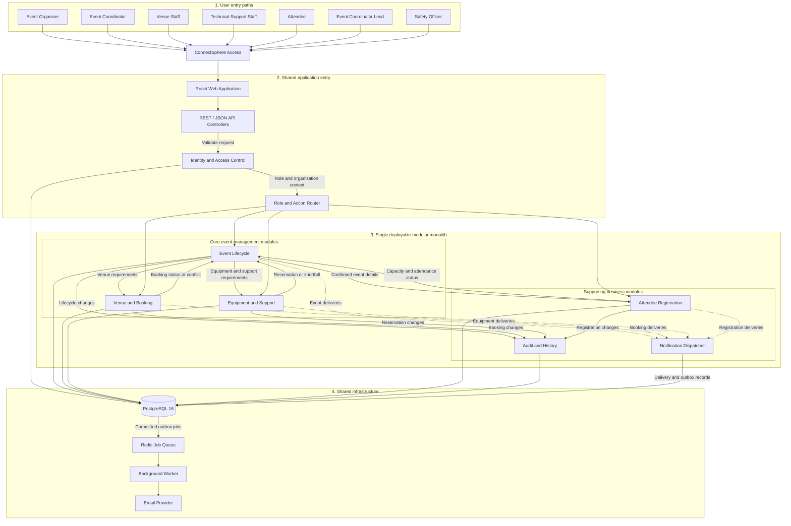

# ConnectSphere Modular Monolith Architecture

## Architecture overview

ConnectSphere is implemented as a single deployable modular monolith. All users enter through one React web application and a shared API layer. The application is separated internally into business modules with clearly defined responsibilities, while PostgreSQL and the notification infrastructure are shared.

An Event contains one or more Sessions. Each Session owns its period, expected attendance, venue and equipment requirements, and Session-linked booking arrangements. Event lifecycle, registration windows and technical-support assignment remain at Event level (T-79).

## Module responsibilities

| Layer | Component | Main responsibility |
|---|---|---|
| User access | React Web Application | Provides a shared interface for all seven user roles. |
| Application entry | API Controllers | Receives REST/JSON requests and routes them into the application. |
| Security | Identity and Access Control | Authenticates users and retrieves all granted role memberships and organisation context. |
| Security | Role and Action Router | Allows an account to use actions permitted by any granted role; the API checks each request independently. Seed accounts start with one role (ADR-019). |
| Business module | Event Lifecycle | Manages event drafts, child Sessions, submission, review, clarification, approval, planning, automatic Safety Review, confirmation, cancellation, completion and Obsolete change-request closure. |
| Business module | Venue and Booking | Maintains venue information, Session-linked booking requests, open-ended editable venue blocks and history, suitability checks, per-hold expiry/warnings/extensions and booking conflicts. |
| Business module | Equipment and Support | Maintains equipment, checks Session-level availability, creates Session-linked reservations, identifies shortfalls and assigns Event-level technical support. |
| Business module | Attendee Registration | Publishes confirmed Events and Sessions; manages one Event-level registration with selected Sessions, Session/combined capacity, Pending Organiser review, Event-level waitlists, withdrawal and attendance. |
| Supporting module | Audit and History | Records important user actions and changes to business records. |
| Supporting module | Notification Dispatcher | Creates and processes notification deliveries arising from business events. |
| Shared infrastructure | PostgreSQL 16 | Stores users, events, bookings, equipment, registrations, audit history and notification delivery records. |
| Shared infrastructure | Redis Job Queue | Queues committed notification jobs for asynchronous processing. |
| Shared infrastructure | Background Worker | Processes queued notification jobs outside the main user request. |
| External service | Email Provider | Delivers confirmation, clarification, waitlist and change-notification emails. |

## Role-to-module access

| User role | Primary modules used |
|---|---|
| Event Organiser | Identity and Access Control, Event Lifecycle, Notification Dispatcher |
| Event Coordinator | Identity and Access Control, Event Lifecycle, Venue and Booking, Equipment and Support, Notification Dispatcher |
| Venue Staff | Identity and Access Control, Venue and Booking, Event Lifecycle, Notification Dispatcher |
| Technical Support Staff | Identity and Access Control, Equipment and Support, Event Lifecycle, Notification Dispatcher |
| Attendee | Identity and Access Control, Attendee Registration, Event Lifecycle, Notification Dispatcher |
| Event Coordinator Lead | Identity and Access Control, Event Lifecycle (unassigned queue, assignment, reassignment, oversight), Notification Dispatcher |
| Safety Officer | Identity and Access Control, Event Lifecycle (Operational Safety Check), Venue and Booking and Equipment and Support (read-only, for the factors), Notification Dispatcher |

An account can appear in multiple role rows because role membership is many-to-many.
The matrix defines the role's allowed modules; it does not require a dedicated
role-switching screen. The frontend displays only the routes/actions allowed by
the account's grants, and each backend action remains independently authorized.

## Architectural interpretation

- The system is deployed as one application rather than as independent microservices.
- Each module owns a distinct business responsibility and communicates with other modules through defined application-level interactions.
- The modules share one PostgreSQL database but should keep their business logic separated.
- Venue and equipment readiness determine whether an approved event can be confirmed.
- A Planning Event enters Safety Review automatically after required venue,
  equipment and technical-support arrangements confirm. A venue block that
  invalidates an active Confirmed booking returns the Event to Planning and
  notifies its Coordinator (T-81/T-82).
- Venue bookings and equipment requirements are Session-scoped; Event lifecycle,
  registration windows and technical-support assignment remain Event-scoped
  (T-79). Registration selects Sessions and enforces both Session and combined
  Event capacity (T-85).
- Notifications are handled asynchronously through committed outbox records, Redis and a background worker.
- Audit records preserve the history of significant actions across the business modules.

## E10-S01 shared application transaction

Approved change requests acquire Event then request locks and preview the real
E10-S02 edit in a rolled-back savepoint. Confirmation rechecks the shared
revision and calls `updateEventInformationWithNotificationsWith` on the same
transaction client. Event fields, request status, arrangement flags, audit and
notification outbox therefore commit or roll back together. The request service
owns the Organiser decision notice; the shared edit owns staff reconfirmation.
Layout/accessibility are now supported in trusted approved-request application.
Individual Session mutation integration remains open.

Layout/accessibility continuation: changed Event requirements flag confirmed venue
bookings for review (T-16), with explicit reasons. Equipment is unaffected by
these requirements alone. The existing sole-Session layout trigger is retained;
no individual multi-Session requirements are overwritten. Layout capacity uses
the shared E09 warning calculation and never removes registered attendees.
