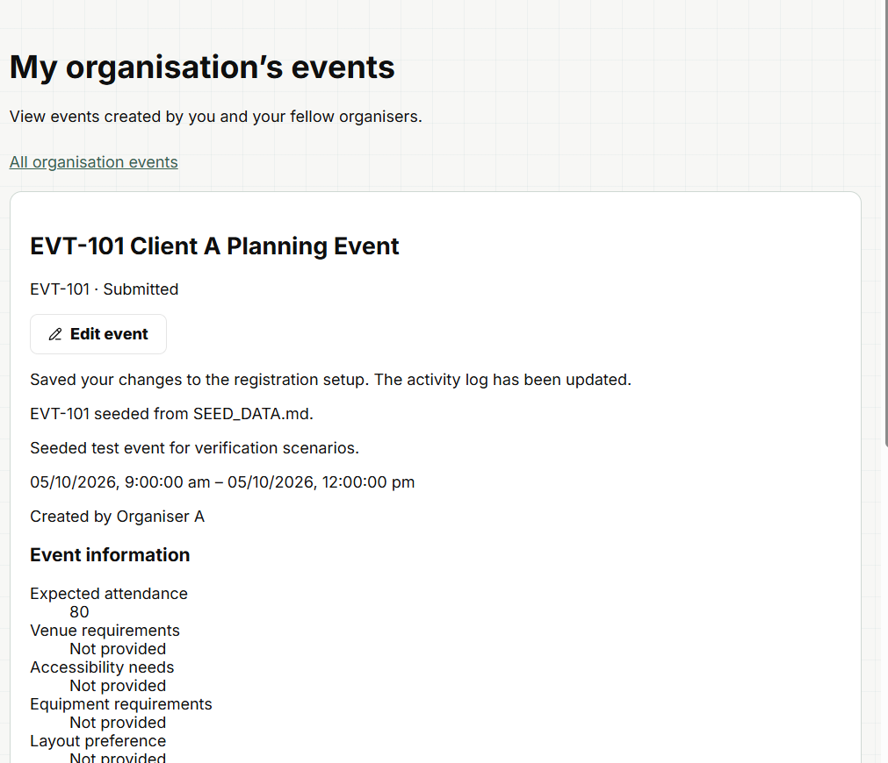
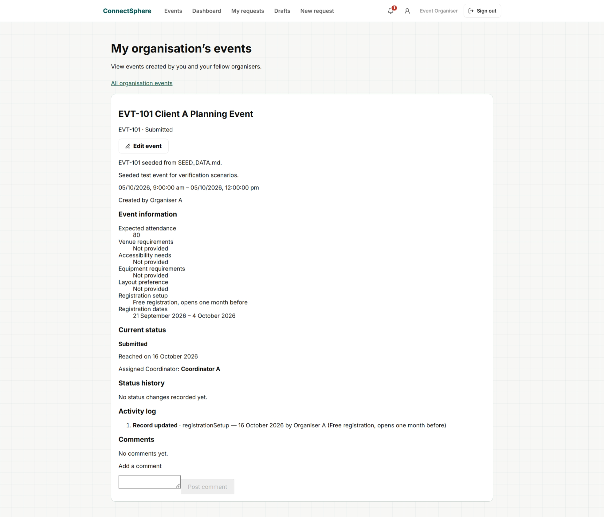
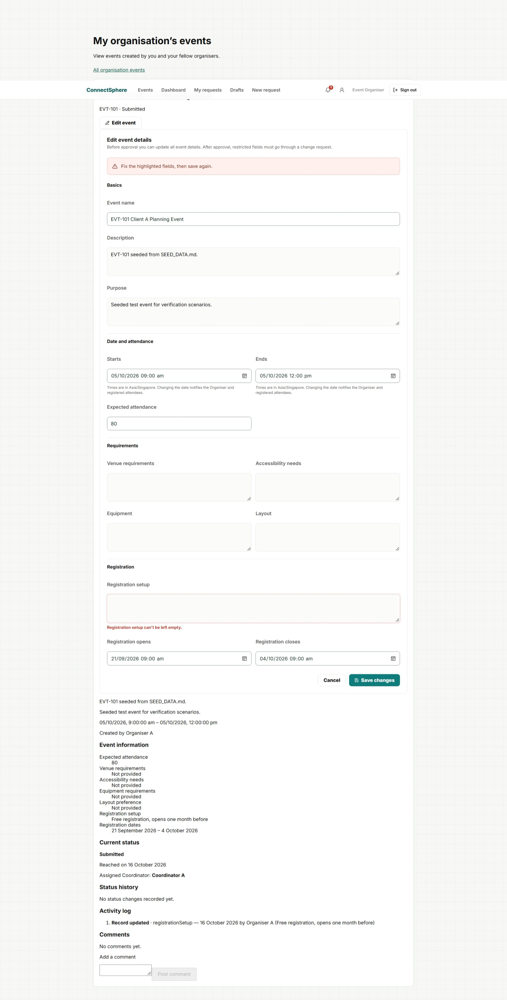
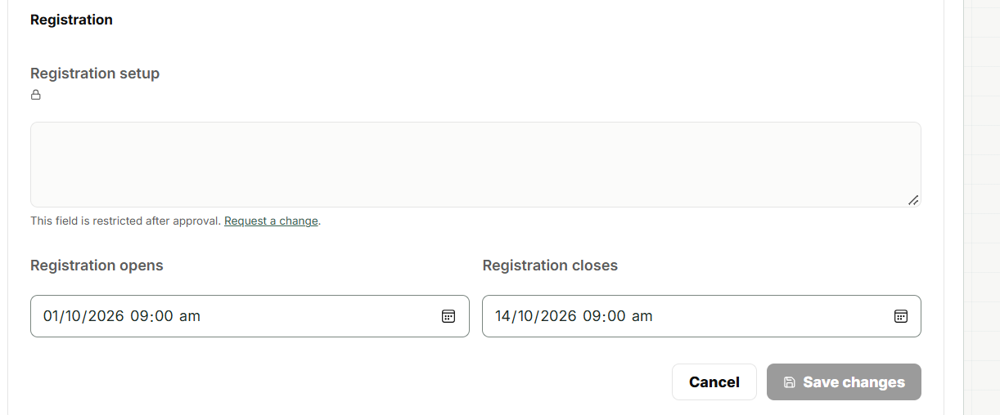
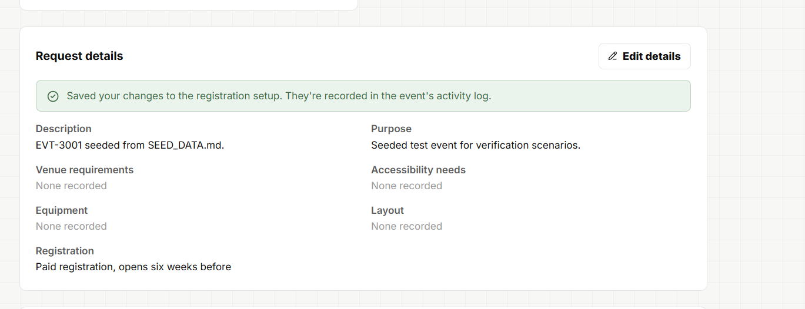
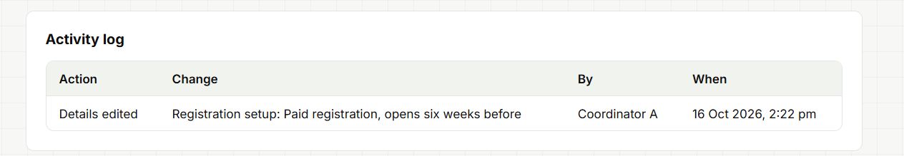
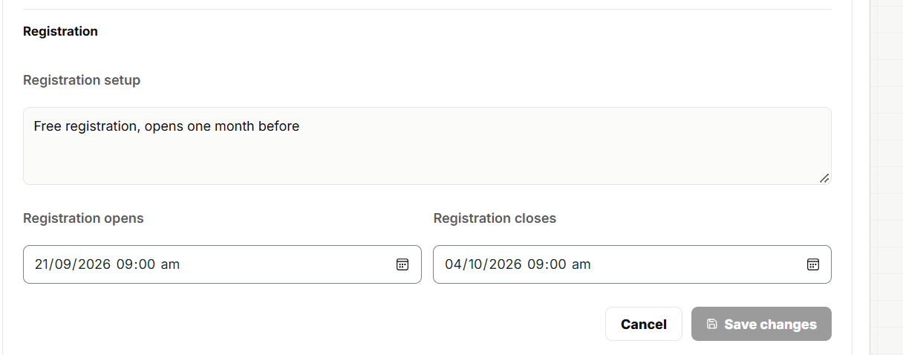
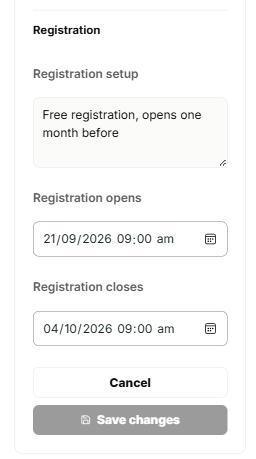

E03-S11 (SCRUM-176) **first** manual run, clicked by hand by Le Xin in
Microsoft Edge on the real local stack: the frontend (`npm run dev`, 5173),
the local API (`backend/src/dev.ts`, 3001, started with only
`DATABASE_URL`) and `connectsphere_dev_stack` (PostgreSQL 17), reset and
seeded just before. E03-S11 is Done but had no manual record (Definition of
Done gap, T-93); this run follows its new test cases TC_E03S11_01 to _05.
The database was checked after each step. Screenshots were taken by hand
(T-93) and are shown below.

Seed data used: EVT-101 Client A Planning Event (Submitted, organiser_a) and
EVT-3001 Approved Annual Conference (Approved, organiser_a, coordinator
coord_a); both started with no registration setup. The cases already use
seeded names, so no substitutions were needed.

| TC_ID | Test Name | Outcome | Remarks |
| --- | --- | --- | --- |
| TC_E03S11_01 | Organiser adds the registration setup before approval, recorded in the activity log | PASS | As organiser_a on EVT-101 (Submitted), entered "Free registration, opens one month before" and saved; the page showed "Saved your changes to the registration setup. The activity log has been updated." as plain text. After reloading, the value was still shown under Event information and the Activity log listed "Record updated · registrationSetup — 16 October 2026 by Organiser A". One audit row by organiser_a at 13:52. Screenshots TC_E03S11_01-1, -2 |
| TC_E03S11_02 | Clearing the registration setup is blocked | PASS | Deleted all the text and saved: red banner "Fix the highlighted fields, then save again." and "Registration setup can't be left empty." under the field. The stored value stayed "Free registration, opens one month before" and no new audit row was written; after Cancel and reload the old value was shown. Screenshot TC_E03S11_02-1 |
| TC_E03S11_03 | Organiser sees the registration setup read-only after approval | PASS | As organiser_a on EVT-3001 (Approved), Registration setup showed a lock icon with "This field is restricted after approval. Request a change."; typing into it entered nothing, and Save changes stayed disabled. Registration opens/closes stayed editable, as E03-S07 allows. EVT-3001 still had no registration setup and no audit row. Screenshot TC_E03S11_03-1 |
| TC_E03S11_04 | Assigned Coordinator edits the registration setup after approval, recorded in the activity log | PASS | As coord_a on EVT-3001, entered "Paid registration, opens six weeks before" and saved: green "Saved your changes to the registration setup. They're recorded in the event's activity log." The Activity log showed "Details edited · Registration setup: Paid registration, opens six weeks before · Coordinator A · 16 Oct 2026, 2:22 pm". One audit row by coord_a at 14:22. Screenshots TC_E03S11_04-1, -2 |
| TC_E03S11_05 | Registration dates shown as two separate labelled fields at desktop and phone width | PASS | As organiser_a on EVT-101: at desktop width "Registration opens" (21/09/2026 09:00 am) and "Registration closes" (04/10/2026 09:00 am) sat side by side, each label above its own box. In Edge device mode at about 390 px they stacked one above the other, labels above their boxes; the page scrolled only up and down, not sideways. Cancelled without saving. Screenshots TC_E03S11_05-1, -2 |

Findings outside E03-S11, not failures of these cases:

- The Organiser's save confirmation is plain text, while the Coordinator's is
  a green alert (TC_E03S11_01-1 vs TC_E03S11_04-1). Raised with the Product
  Owner as a separate fix.
- The Organiser's Activity log shows the stored action and field name
  ("Record updated · registrationSetup"), while the Coordinator's shows
  "Details edited · Registration setup".
- TC_E03S11_02-1 was a full-page capture over 1000 KB and was saved as JPG
  without cropping (T-93).

## Screenshots

TC_E03S11_01-1 · "Saved your changes to the registration setup" on EVT-101

TC_E03S11_01-2 · value after reload and the Activity log entry by Organiser A

TC_E03S11_02-1 · "Registration setup can't be left empty."

TC_E03S11_03-1 · locked field with "Request a change" on EVT-3001

TC_E03S11_04-1 · Coordinator's saved message and new value on EVT-3001

TC_E03S11_04-2 · Activity log entry by Coordinator A

TC_E03S11_05-1 · registration dates at desktop width

TC_E03S11_05-2 · registration dates at about 390 px
