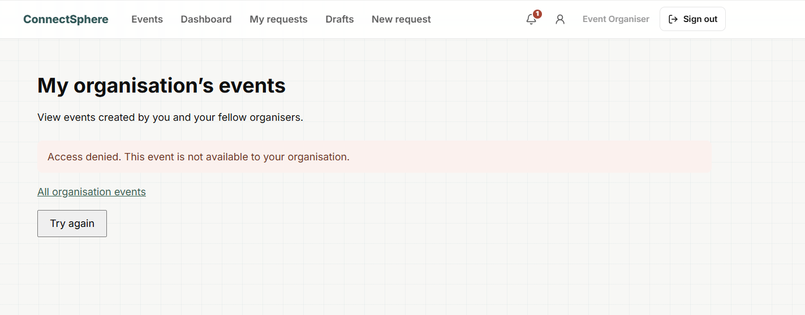
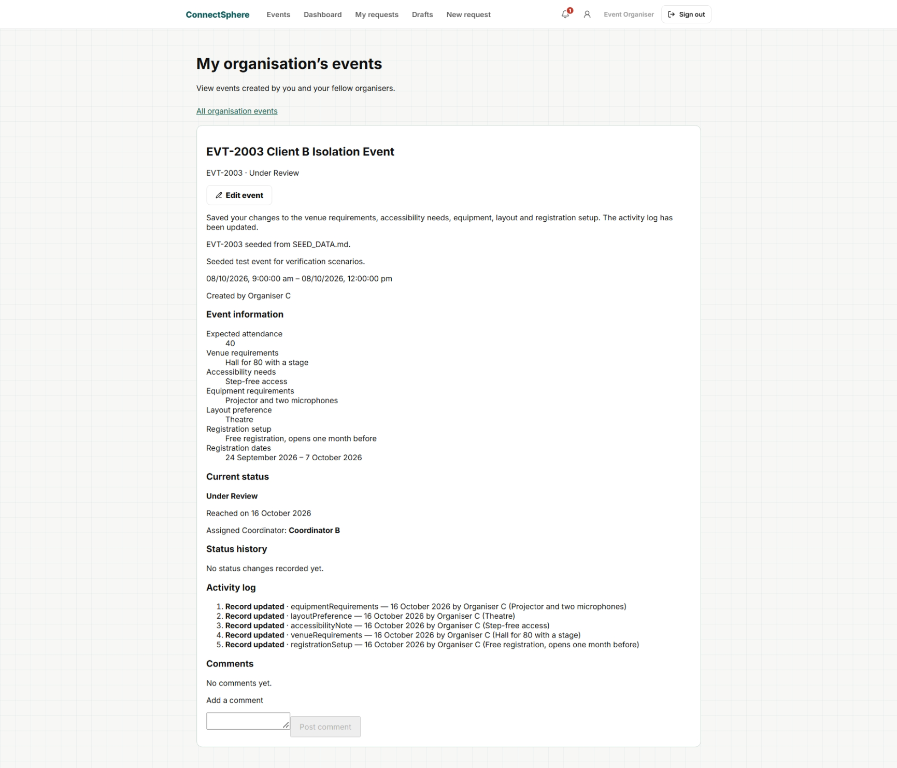
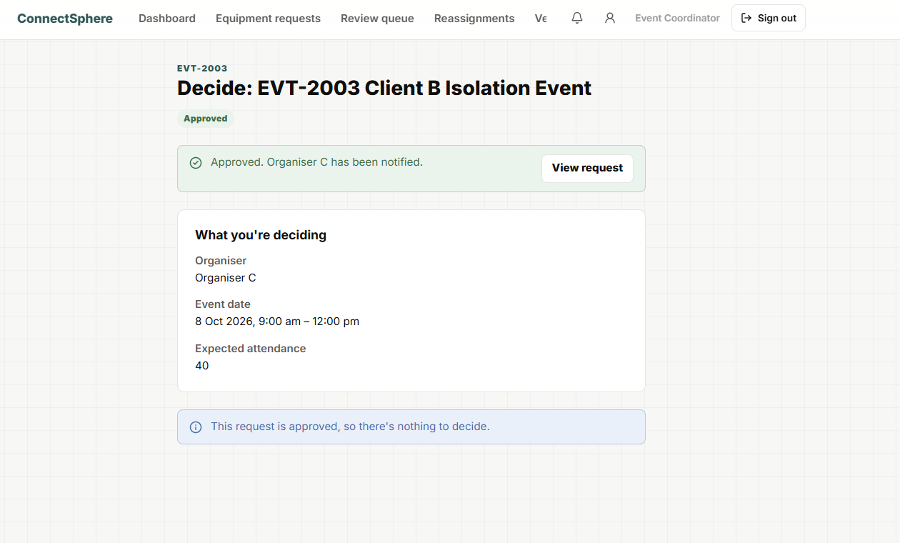
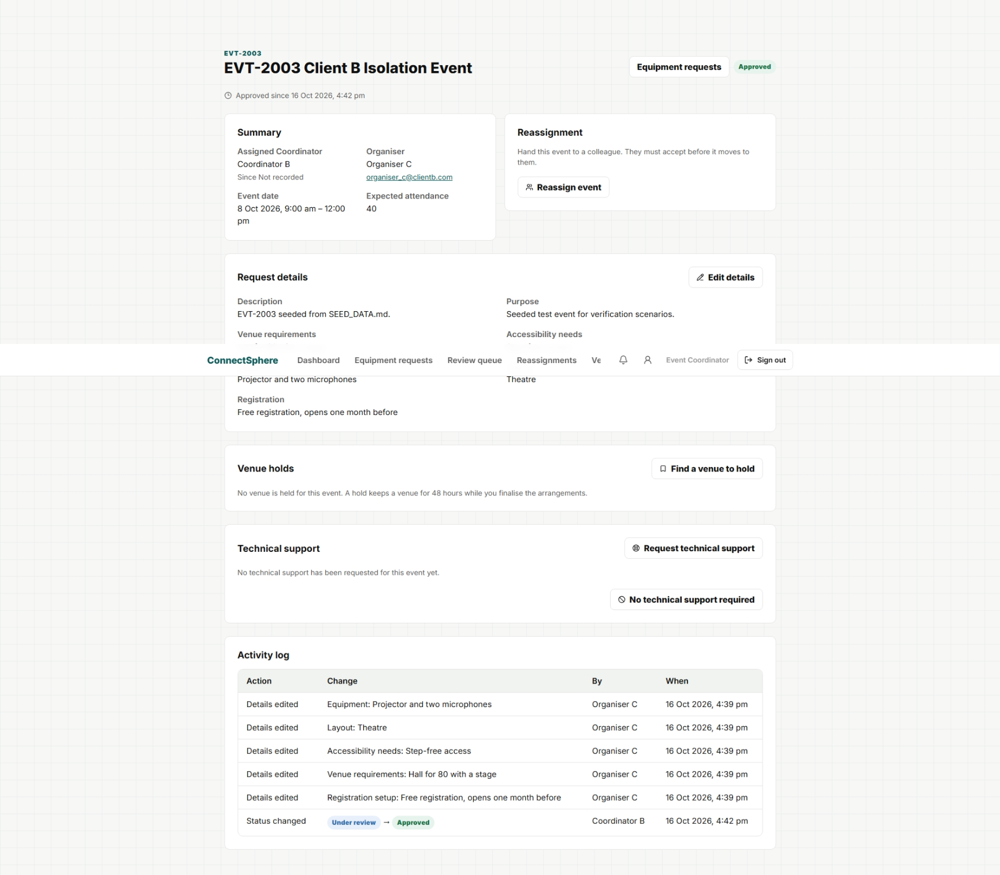
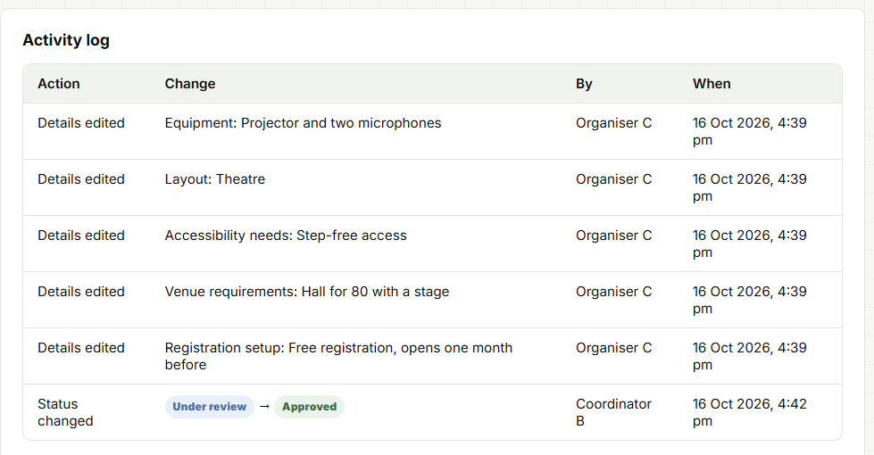
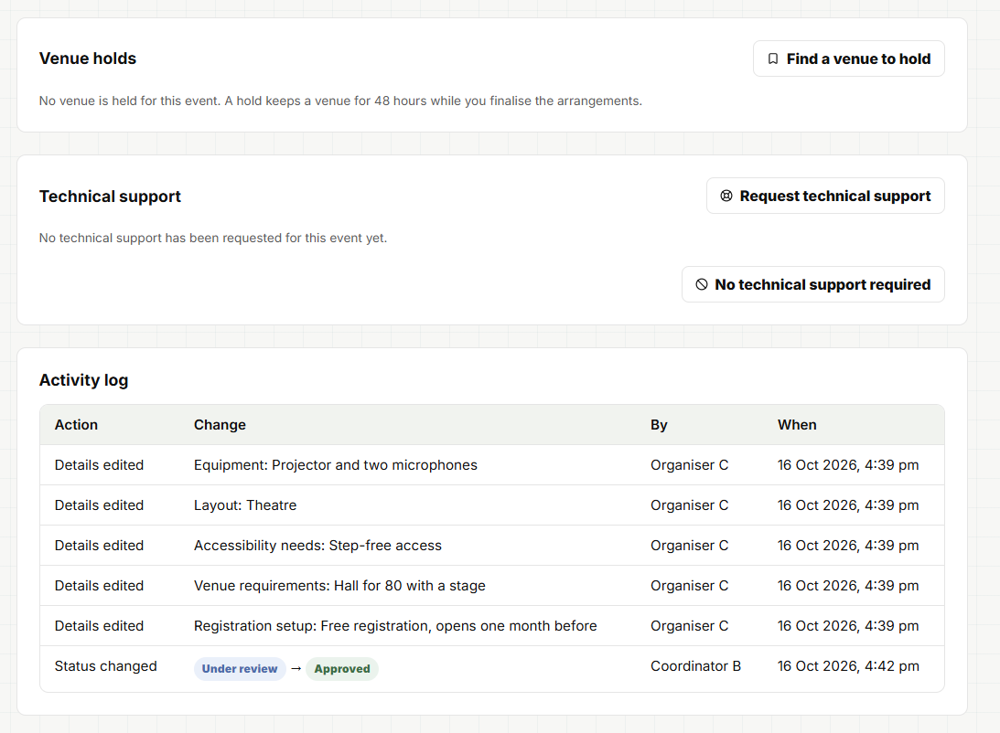
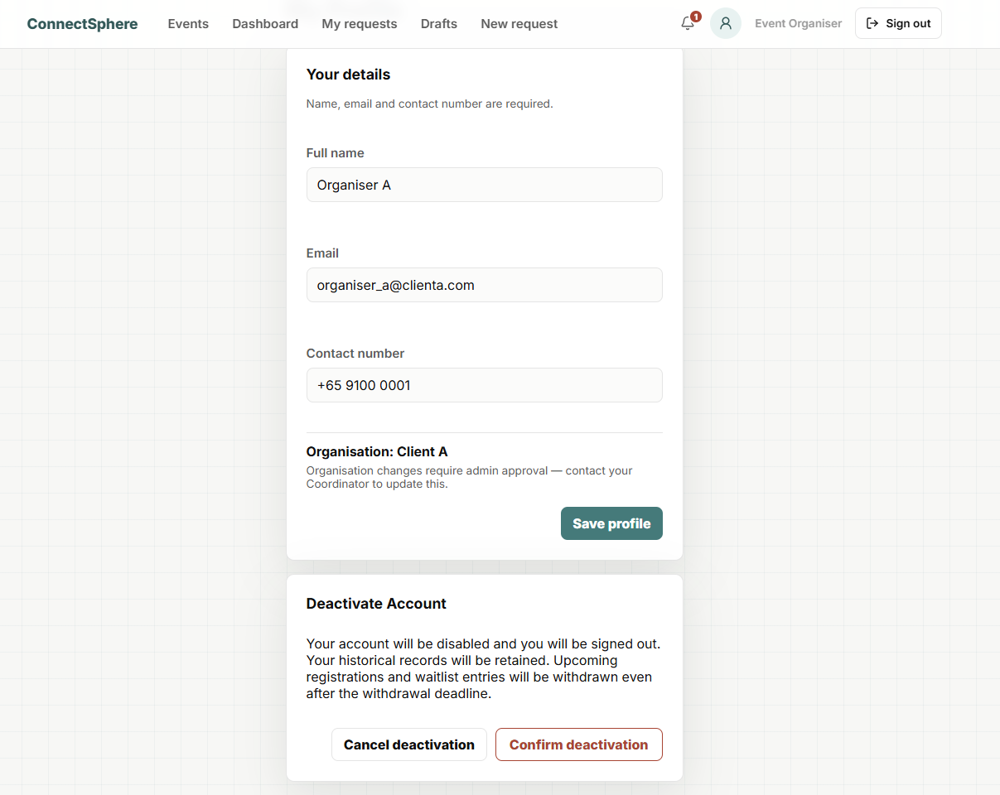
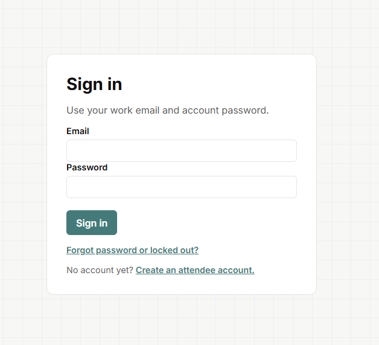

E14-S02 (SCRUM-86) **re-run with screenshots** before the Sprint 3 Review, as
T-93 requires for Sprint 3 Done stories. Clicked by hand by Le Xin in
Microsoft Edge on the real local stack: the frontend (`npm run dev`, 5173),
the local API (`backend/src/dev.ts`, 3001, started with only
`DATABASE_URL`) and `connectsphere_dev_stack` (PostgreSQL 17), reset and
seeded just before, at current `main`. The story stays Done (T-74); the
8 October record `20261008-181200-lexinphun2024-debug-frontend-e2e.md` is
unchanged. The database was checked after each part. Screenshots were taken
by hand (T-93) and are shown below. TC_E14S02_03, _06 and _07 are retired
(moved to E06-S04 by T-76) and are not part of this run.

Seed substitutions for the placeholder data in `docs/testing/cases/E14.md`:
`coordinator_1` -> `coord_b@connectsphere.com`; "Annual Tech Summit" and
"EVT-B01" -> EVT-2003 (Client B, Under Review, assigned to coord_b);
`organiser_a@clienta.com` as written. Set-up for TC_E14S02_01: as
`organiser_c@clientb.com` the missing venue requirements, accessibility
needs, equipment, layout and registration setup were filled in through the
Organiser edit form, so EVT-2003 could be approved (screenshot
TC_E14S02_01-0). Unlike the 8 October run, no database change was needed:
E03-S11 (#247) added registration setup to that form. The seed already holds
one Access Denied and one Account Deactivated row from 15:50; only rows from
this run are cited below.

| TC_ID | Test Name | Outcome | Remarks |
| --- | --- | --- | --- |
| TC_E14S02_02 | A denied access attempt is recorded with the user, target and time | PASS | organiser_a opened /events/EVT-2003 and saw "Access denied. This event is not available to your organisation."; audit_logs row: user organiser_a@clienta.com, action Access Denied, target EVT-2003, 16:38:12. Screenshot TC_E14S02_02-1 |
| TC_E14S02_01 | An event status change is recorded with the actor, action, affected event and time | PASS | coord_b approved EVT-2003 and saw "Approved. Organiser C has been notified."; the Coordinator event page Activity log showed "Status changed · Under review → Approved · Coordinator B · 16 Oct 2026, 4:42 pm" below Organiser C's five "Details edited" rows; audit_logs row by coord_b, "Status changed to approved", under_review -> approved, 16:42:07. Screenshots TC_E14S02_01-0 (set-up), -1, -2 |
| TC_E14S02_08 | Access-denial entries are not shown in the event Activity log a Coordinator reads | PASS | coord_b's Activity log for EVT-2003 listed only the five Organiser C edits and the approval: no Access Denied row and no "Organiser A"; the database still held organiser_a's Access Denied row for EVT-2003 (16:38:12). Screenshot TC_E14S02_08-1 |
| TC_E14S02_05 | Any attempt to edit or delete an activity log entry is refused | PASS | The Activity log card showed no edit, delete or other controls on any row; no application route edits or deletes audit_logs, so the per-role API step had nothing to call; UPDATE (action to "Status changed to rejected") and DELETE of the approval row through the database were each refused with "Activity log entries cannot be edited or deleted." and the row was unchanged afterwards. Screenshot TC_E14S02_05-1 |
| TC_E14S02_04 | An account deactivation is recorded in the activity log | PASS | organiser_a opened Profile, chose Deactivate Account, saw the warning with Cancel deactivation and Confirm deactivation, confirmed, and was returned to the Sign in page; audit_logs row: actor organiser_a@clienta.com, entity user, action Account Deactivated, 16:47:29; the account is inactive with no sessions left. Screenshots TC_E14S02_04-1, -2 |

Findings outside E14-S02, not failures of these cases:

- The Organiser's event page shows its activity entries as "Record updated ·
  equipmentRequirements" (stored names), while the Coordinator's Activity log
  shows "Details edited · Equipment" (TC_E14S02_01-0 vs TC_E14S02_01-2).
- An edited date or time appears in the Coordinator's Activity log as raw UTC
  (found in the SCRUM-189 run); not exercised here, tracked as a new story.

## Screenshots

TC_E14S02_02-1 · organiser_a refused on EVT-2003

TC_E14S02_01-0 · set-up: Organiser C completes EVT-2003's required fields

TC_E14S02_01-1 · coord_b approves EVT-2003

TC_E14S02_01-2 · Coordinator event page with the "Status changed" row

TC_E14S02_08-1 · Activity log: no Access denied row, no Organiser A

TC_E14S02_05-1 · Activity log with no edit or delete controls

TC_E14S02_04-1 · deactivation warning with Cancel and Confirm

TC_E14S02_04-2 · signed out to the Sign in page after deactivating
